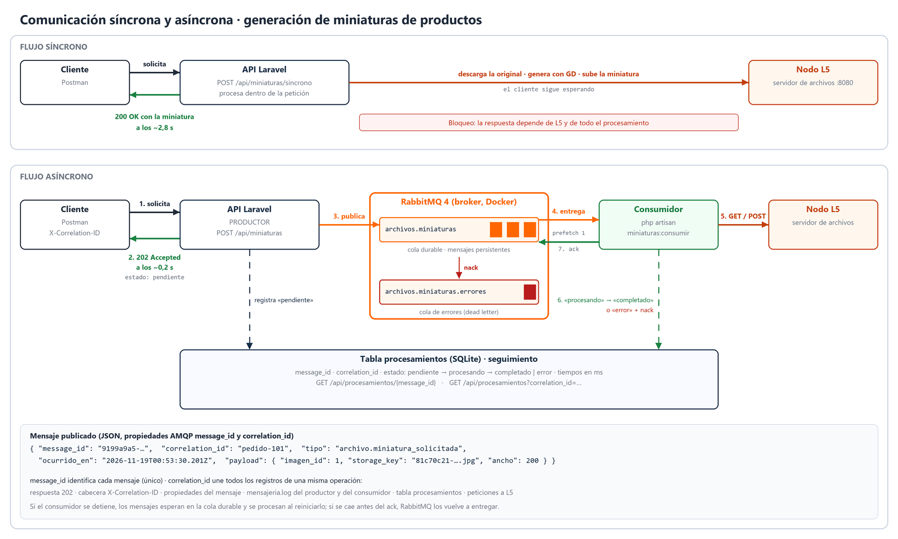

# Comunicación asíncrona · miniaturas de productos · IS-803 tema 3.1

Práctica individual · rama `asincrono-angel17jc`.

**Proceso elegido:** generar la **miniatura** de la imagen de un producto guardada en el **Nodo L5** (servidor de archivos). Es trabajo pesado que el cliente no necesita esperar: descargar la imagen original, reducirla y subir la versión pequeña.

- **Productor:** API Laravel, `POST /api/miniaturas`.
- **Broker:** RabbitMQ 4, cola `archivos.miniaturas`.
- **Consumidor:** `php artisan miniaturas:consumir`.



## Componentes

| Componente | Dónde | Qué hace |
|---|---|---|
| Productor | [MiniaturaController::solicitar](app/Http/Controllers/MiniaturaController.php) | Valida el JSON; genera o conserva el `correlation_id`; registra el estado `pendiente`; publica en la cola; responde **202 Accepted** |
| Cola | `archivos.miniaturas`, durable, mensajes persistentes ([ConexionRabbit](app/Mensajeria/ConexionRabbit.php)) | Guarda los mensajes hasta que un consumidor los procese |
| Cola de errores | `archivos.miniaturas.errores` (dead letter) | Recibe los mensajes rechazados con nack |
| Consumidor | [ConsumirMiniaturas](app/Console/Commands/ConsumirMiniaturas.php) y [ProcesadorMiniaturas](app/Services/ProcesadorMiniaturas.php) | Toma un mensaje a la vez (prefetch 1); genera la miniatura; actualiza el estado; confirma con **ack** |
| Trabajo | [GeneradorMiniaturas](app/Services/GeneradorMiniaturas.php) | Descarga de L5, genera con GD y sube a L5 (lo usan el consumidor y el modo síncrono) |
| Estados | Tabla `procesamientos` | `pendiente` → `procesando` → `completado` o `error`, con tiempos en ms |
| Registro | `storage/logs/mensajeria.log` | Cada paso del productor y del consumidor con su `correlation_id` |

## Mensaje

```json
{
  "message_id": "9199a9a5-3965-470c-bda3-5ac6e17db114",
  "correlation_id": "pedido-101",
  "tipo": "archivo.miniatura_solicitada",
  "ocurrido_en": "2026-11-19T00:53:30.201Z",
  "payload": { "imagen_id": 1, "storage_key": "81c70c21-c96c-41f7-b2b3-79e5690a918f.jpg", "ancho": 200 }
}
```

- **`message_id`** identifica **este mensaje**. Es único y permite reconocer duplicados: si RabbitMQ entrega dos veces un mensaje ya completado, el consumidor no repite el trabajo.
- **`correlation_id`** une **todos los registros de una operación**. El cliente lo envía en `X-Correlation-ID` o en el cuerpo; si no lo envía, la API genera uno. Aparece en la respuesta 202, en las propiedades AMQP del mensaje, en el registro del productor y del consumidor, en la tabla de estados y en las peticiones a L5.
- El mensaje lleva **solo lo necesario**: la imagen y el ancho. No incluye datos personales ni credenciales.

## Confirmación y errores

| Situación | Qué ocurre |
|---|---|
| Procesado correctamente | Estado `completado` y **ack**: RabbitMQ borra el mensaje |
| Falla el procesamiento (por ejemplo, L5 no tiene la imagen) | Estado `error` con el motivo; **nack sin reencolar**: RabbitMQ lo mueve a `archivos.miniaturas.errores` para revisarlo, sin bloquear la cola |
| El consumidor se detiene antes del ack | RabbitMQ vuelve a entregar el mensaje al reconectarse un consumidor |
| Mensaje duplicado ya completado | Se confirma sin repetir el trabajo (idempotencia por `message_id`) |
| El broker no responde al publicar | La API responde **503** y marca el estado `error` |
| Consumidor detenido | Los mensajes esperan en la cola durable y se procesan al reiniciarlo |

## Ejecución

```bash
composer install
cp .env.example .env          # complete RABBITMQ_PASSWORD y L5_FILES_API_KEY
php artisan key:generate
php artisan migrate
docker compose up -d          # RabbitMQ en 127.0.0.1:5672, panel en http://127.0.0.1:15672
php artisan demo:preparar-imagenes   # sube 3 fotos de producto ficticias al Nodo L5
```

```powershell
powershell -ExecutionPolicy Bypass -File .\iniciar-asincrono.ps1   # abre la API (:8200) y el consumidor
```

| Comando | Para qué |
|---|---|
| `php artisan miniaturas:consumir` | Inicia el consumidor (Ctrl+C para detenerlo) |
| `php artisan miniaturas:cola` | Muestra los mensajes pendientes y los consumidores de cada cola |
| `php artisan demo:limpiar` | Borra de L5 las imágenes y miniaturas de la demostración y vacía colas y tablas |

**Variables de entorno** (solo los nombres): `RABBITMQ_HOST`, `RABBITMQ_PORT`, `RABBITMQ_USER`, `RABBITMQ_PASSWORD`, `RABBITMQ_VHOST`, `MINIATURAS_COLA`, `MINIATURAS_COLA_ERRORES`, `MINIATURAS_RETRASO_MS`, `L5_FILES_URL`, `L5_FILES_API_KEY`.

- `.env` está excluido de Git.
- RabbitMQ rechaza el usuario por defecto `guest` y solo escucha en `127.0.0.1`.
- `MINIATURAS_RETRASO_MS` (2500 ms) **simula** el trabajo adicional de optimizar varias versiones de la imagen, para que la diferencia entre síncrono y asíncrono se aprecie. El resto del proceso es real.

## Pruebas

**Automatizadas:** `php artisan test`, 13 pruebas (11 de la práctica y 2 de ejemplo de Laravel). Usan un publicador en memoria y `Http::fake()`, así que no necesitan RabbitMQ ni L5.

**Manuales:** importa [postman/Asincrono.postman_collection.json](postman/Asincrono.postman_collection.json).

## Resultados medidos

| Criterio | Síncrono | Asíncrono |
|---|---|---|
| Respuesta inicial al cliente | **2,76–2,83 s** con curl; 3,12 s en Postman (200, con la miniatura) | **0,17–0,26 s** con curl; 0,53–0,78 s en Postman (202, `pendiente`) |
| Fin del trabajo | Al responder | Unos 2,6 s después, en el consumidor |
| Consumidor detenido | No aplica | 202 igual; 1 mensaje pendiente en la cola; procesado al reiniciar (esperó 6,2 s) |
| Falla de L5 | El cliente espera y recibe 502 | 202; estado `error`; mensaje en la cola de errores |
| Varios pedidos seguidos | Cada cliente espera su procesamiento completo | Respuestas inmediatas; el consumidor procesa en orden (el 3.º esperó 4,7 s en la cola) |
| Trazabilidad | Una petición | `message_id` y `correlation_id` en la respuesta, el mensaje, los registros y la tabla |
