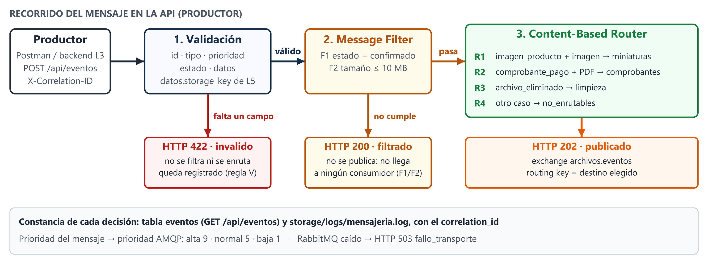
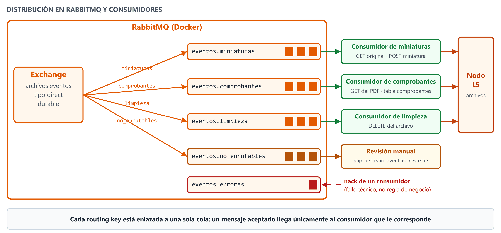

# Enrutamiento y filtrado de eventos de archivos · IS-803 tema 3.2

Práctica individual · rama `enrutamiento-angel17jc` · Angel Joshue Conforme Anchundia.

**Proceso elegido:** los **eventos de archivos del Nodo L5** (servidor de archivos de la tienda en línea). Cuando el backend (L3) registra una foto de producto, recibe un comprobante de pago o da de baja un archivo, se produce un evento distinto, y cada uno necesita un tratamiento diferente. Esta práctica reutiliza el backend de la práctica 3.1 (rama `asincrono-angel17jc`): conexión a RabbitMQ, publicador, `correlation_id`, registro `mensajeria.log` y generador de miniaturas.

Flujo: **productor → validación → Message Filter → Content-Based Router → consumidor / no_enrutables**.




## Tipos de mensaje y consumidores

| Tipo | Ejemplo en la tienda | Consumidor | Qué hace |
|---|---|---|---|
| `imagen_producto` | Foto de producto subida a L5 (`products/…jpg`) | Consumidor de miniaturas | Descarga la imagen de L5, genera la miniatura de 200 px y la sube a L5 |
| `comprobante_pago` | Comprobante de pago del cliente (`payments/…pdf`) | Consumidor de comprobantes | Descarga el PDF, comprueba que sea un PDF real, calcula su SHA-256 y lo registra «por revisar» para L3 |
| `archivo_eliminado` | Archivo dado de baja en el backend | Consumidor de limpieza | Elimina el binario de L5 (si ya no existía, no falla: es idempotente) |
| Cualquier otro | p. ej. `factura_proveedor` | Revisión manual | Espera en `eventos.no_enrutables` (`php artisan eventos:revisar`) |

## Contrato del mensaje

```json
{
  "id": "evt-3002",
  "tipo": "comprobante_pago",
  "prioridad": "alta",
  "estado": "confirmado",
  "correlation_id": "pedido-1002",
  "datos": {
    "storage_key": "payments/12e24c15-eaa3-423f-89b9-bfe5f020cef6.pdf",
    "tamano_bytes": 927,
    "referencia": "PED-1002"
  }
}
```

| Campo | Tipo | Obligatorio | Regla |
|---|---|---|---|
| `id` | texto | sí | 1–100 letras, números, `.`, `-` o `_` |
| `tipo` | texto | sí | Cualquier valor: un tipo desconocido no es un error de validación, lo resuelve el enrutador (R4) |
| `prioridad` | texto | sí | `alta`, `normal` o `baja` |
| `estado` | texto | sí | Estado de la operación en el backend (`confirmado`, `cancelado`…) |
| `datos.storage_key` | texto | sí | Formato de L5 `carpeta/uuid.extensión`; impide rutas arbitrarias hacia L5 |
| `datos.tamano_bytes` | entero | no | ≥ 0 |
| `datos.referencia` | texto | no | Producto o pedido relacionado |
| `correlation_id` | texto | no | También por cabecera `X-Correlation-ID`; si no llega, se genera (igual que en la 3.1) |

## Reglas

**Message Filter** ([FiltroMensajes](app/Enrutamiento/FiltroMensajes.php)), se aplica antes del enrutador:

| Regla | Condición de aceptación | Si no se cumple |
|---|---|---|
| F1 | `estado` = `confirmado` | HTTP 200 `filtrado`: no se publica, ningún consumidor lo recibe |
| F2 | `datos.tamano_bytes` ≤ 10 MB (límite de L5) | HTTP 200 `filtrado` |

**Content-Based Router** ([EnrutadorContenido](app/Enrutamiento/EnrutadorContenido.php)):

| Regla | Condición | Routing key → cola | Justificación |
|---|---|---|---|
| R1 | `tipo` = `imagen_producto` y archivo `.jpg`, `.png` o `.webp` | `miniaturas` → `eventos.miniaturas` | El catálogo necesita la versión pequeña de cada foto |
| R2 | `tipo` = `comprobante_pago` y archivo `.pdf` | `comprobantes` → `eventos.comprobantes` | Verificar el comprobante antes de que L3 confirme el pago |
| R3 | `tipo` = `archivo_eliminado` | `limpieza` → `eventos.limpieza` | Liberar espacio en L5 cuando el backend da de baja un archivo |
| R4 | Cualquier otro caso: tipo desconocido o contenido que no coincide con el tipo | `no_enrutables` → `eventos.no_enrutables` | No se descarta en silencio: queda para revisión manual |
| Prioridad | `alta` / `normal` / `baja` | Prioridad AMQP 9 / 5 / 1 | Dentro de cada cola se entrega primero lo urgente |

## Respuestas y constancia

| Situación | HTTP | `resultado` | ¿Se publica? |
|---|---|---|---|
| Enrutado (R1–R3) | 202 | `enrutado` | Sí, a la cola de su consumidor |
| Tipo o contenido no reconocido (R4) | 202 | `no_enrutable` | Sí, a `eventos.no_enrutables` |
| No cumple el filtro (F1, F2) | 200 | `filtrado` | No |
| Falta un campo obligatorio | 422 | `invalido` | No |
| RabbitMQ no disponible | 503 | `fallo_transporte` | No (fallo técnico, distinto de un rechazo por regla de negocio) |
| Falla el procesamiento en un consumidor | — | `procesamiento: error` | El consumidor hace `nack` y RabbitMQ lo mueve a `eventos.errores` |

Cada decisión queda en la tabla `eventos` (`GET /api/eventos`, `GET /api/eventos/{message_id}`, `php artisan eventos:historial`) y en `storage/logs/mensajeria.log`, con su `correlation_id`.

## Topología en RabbitMQ

- Exchange **`archivos.eventos`**, tipo `direct`, durable.
- Colas durables con `x-max-priority` 10 y `x-dead-letter-routing-key` `eventos.errores`: `eventos.miniaturas`, `eventos.comprobantes`, `eventos.limpieza` y `eventos.no_enrutables`. Cada una está enlazada al exchange con su routing key.
- Publicación con `mandatory` y *publisher confirms*: si el broker no confirma el mensaje o no hay cola para la routing key, la API responde 503 en lugar de darlo por enviado.

## Ejecución

```bash
composer install --ignore-platform-req=ext-sockets   # ver nota
cp .env.example .env          # complete RABBITMQ_PASSWORD y L5_FILES_API_KEY
php artisan key:generate
php artisan migrate
docker compose up -d          # RabbitMQ en 127.0.0.1:5672, panel en http://127.0.0.1:15672
php artisan demo:preparar     # sube a L5 una foto, un comprobante PDF y una foto para dar de baja (ficticios)
```

```powershell
powershell -ExecutionPolicy Bypass -File .\iniciar-enrutamiento.ps1
# levanta L5 y RabbitMQ y abre la API (:8300), los tres consumidores y una ventana de seguimiento
```

| Comando | Para qué |
|---|---|
| `php artisan eventos:consumir {miniaturas\|comprobantes\|limpieza}` | Inicia un consumidor (Ctrl+C para detenerlo) |
| `php artisan eventos:colas` | Mensajes pendientes y consumidores de cada cola |
| `php artisan eventos:revisar [--retirar]` | Muestra los mensajes de `eventos.no_enrutables` y el motivo |
| `php artisan eventos:historial` | Decisión y consumidor de los últimos mensajes |
| `php artisan demo:limpiar` | Borra de L5 los archivos de la demostración y vacía colas y tablas |

- **Nota sobre `ext-sockets`:** php-amqplib la declara como requisito, pero la conexión `AMQPStreamConnection` solo la usa para el *keepalive*, que aquí no se activa. Así no hace falta modificar el `php.ini` del equipo.
- **Variables de entorno** (solo los nombres): `RABBITMQ_HOST`, `RABBITMQ_PORT`, `RABBITMQ_USER`, `RABBITMQ_PASSWORD`, `RABBITMQ_VHOST`, `ENRUTAMIENTO_EXCHANGE`, `ENRUTAMIENTO_COLA_ERRORES`, `FILTRO_TAMANO_MAXIMO_BYTES`, `MINIATURAS_ANCHO`, `MINIATURAS_RETRASO_MS`, `L5_FILES_URL`, `L5_FILES_API_KEY`.
- `.env` está excluido de Git. RabbitMQ no crea el usuario `guest` y solo escucha en `127.0.0.1`. Todos los datos de prueba son ficticios.

## Pruebas

**Automatizadas:** `php artisan test`, 26 pruebas (24 de la práctica y 2 de ejemplo de Laravel). Usan un publicador en memoria y `Http::fake()`, así que no necesitan RabbitMQ ni L5. Cubren los tres destinos, los dos casos de R4, F1, F2, la validación, el fallo de transporte, la correlación y los tres consumidores.

**Manuales:** importa [postman/Enrutamiento.postman_collection.json](postman/Enrutamiento.postman_collection.json). `demo:preparar` escribe en sus variables las claves de los archivos de prueba.

| Caso | Entrada | Resultado obtenido |
|---|---|---|
| 1 | `imagen_producto` | 202 · R1 · solo el consumidor de miniaturas lo recibe; miniatura 200x150 creada en L5 |
| 2 | `comprobante_pago` | 202 · R2 · solo el consumidor de comprobantes; PDF verificado y registrado |
| 3 | `archivo_eliminado` | 202 · R3 · solo el consumidor de limpieza; L5 devuelve 404 para el archivo después |
| 4 | `factura_proveedor` (desconocido) | 202 · R4 · queda en `eventos.no_enrutables`; ningún consumidor automático lo recibe |
| 5 | `comprobante_pago` con `estado` `cancelado` | 200 · F1 · `filtrado`; no se publica |
| 6 | Sin `tipo` | 422 · «Falta el campo tipo.»; no se filtra ni se enruta |
| Extra | Prioridades baja, normal y alta con el consumidor detenido | Al iniciarlo atiende alta → normal → baja |
| Extra | RabbitMQ detenido | 503 `fallo_transporte` |
