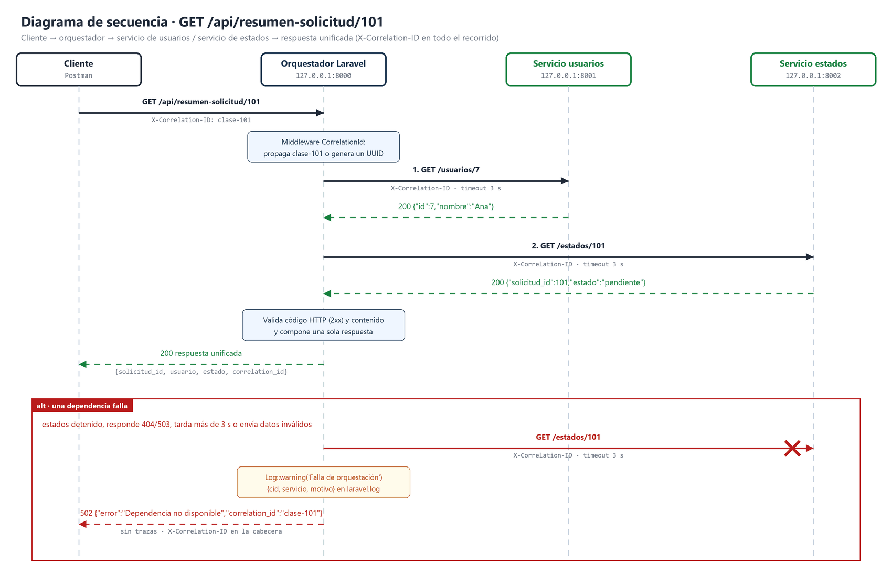
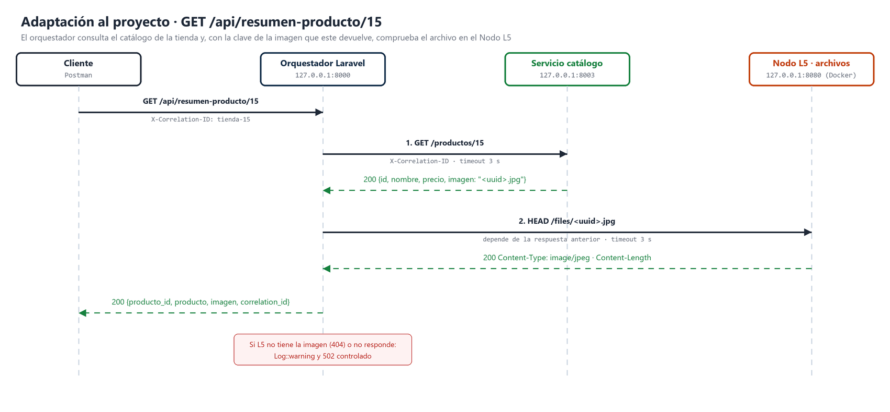

# Orquestación y composición de capacidades · Nodo L5

Backend orquestador en **Laravel 13** (PHP 8.4). Recibe una petición, consulta **dos servicios HTTP independientes**, valida sus respuestas y compone una **respuesta unificada**. Si una dependencia falla, responde un **502 controlado** sin trazas y deja el error registrado con su `X-Correlation-ID`.

Además de reproducir la actividad, incluye una **adaptación a nuestro proyecto** (la tienda en línea de 5 nodos): un resumen de producto que consulta el catálogo y comprueba la imagen en el **Nodo L5**, nuestro servidor de archivos.



## Correspondencia con la actividad

| N.º | Requisito | Dónde está |
|---|---|---|
| 01 | Servicios `/usuarios/7` y `/estados/101` | [servicios/usuarios.php](servicios/usuarios.php) y [servicios/estados.php](servicios/estados.php): APIs independientes, cada una en su propio puerto |
| 02 | `GET /api/resumen-solicitud/101` con `Http::timeout(3)->get(...)` | [ResumenSolicitudController](app/Http/Controllers/ResumenSolicitudController.php) y [ClienteDependencias](app/Services/ClienteDependencias.php) |
| 03 | Validar códigos y responder 502 controlado, sin trazas | [ClienteDependencias](app/Services/ClienteDependencias.php) y [DependenciaNoDisponible](app/Exceptions/DependenciaNoDisponible.php); `APP_DEBUG=false` |
| 04 | JSON con `solicitud_id`, `usuario`, `estado`, `correlation_id`; generar o propagar `X-Correlation-ID` | [ResumenSolicitudController](app/Http/Controllers/ResumenSolicitudController.php) y middleware [CorrelationId](app/Http/Middleware/CorrelationId.php) |
| 05 | Flujo normal y servicio que no responde en Postman; comparar respuesta y registro | [Colección de Postman](postman/Orquestacion.postman_collection.json) y `storage/logs/laravel.log` |
| 06 | Secuencia cliente → orquestador → usuarios / estados → respuesta | [docs/diagrama-secuencia.png](docs/diagrama-secuencia.png) |

## Requisitos

- PHP 8.3 o superior con las extensiones habituales de Laravel, y [Composer](https://getcomposer.org).
- Postman para las pruebas manuales.
- Solo para la adaptación: el Nodo L5 en Docker (`docker compose up -d` en la raíz del repositorio).

## Instalación

```bash
cd orquestador-laravel
composer install
cp .env.example .env
php artisan key:generate
```

Las direcciones de los servicios están en `.env` y se leen desde [config/orquestacion.php](config/orquestacion.php):

```dotenv
USERS_URL=http://127.0.0.1:8001
STATUS_URL=http://127.0.0.1:8002
ORQUESTACION_TIMEOUT=3
```

## Ejecución

Cada servicio corre en **su propio proceso**. En Windows, el script abre una ventana por proceso:

```powershell
powershell -ExecutionPolicy Bypass -File .\iniciar-orquestacion.ps1
```

O, a mano, en cuatro terminales:

```bash
php -S 127.0.0.1:8001 servicios/usuarios.php     # servicio de usuarios
php -S 127.0.0.1:8002 servicios/estados.php      # servicio de estados
php -S 127.0.0.1:8003 servicios/catalogo.php     # catálogo (solo para la adaptación)
php artisan serve --host=127.0.0.1 --port=8000   # orquestador
```

## Demostración

Importa en Postman [postman/Orquestacion.postman_collection.json](postman/Orquestacion.postman_collection.json). Cada petición trae comprobaciones automáticas en la pestaña *Test Results*.

### Flujo normal: HTTP 200

```bash
curl -i -H "X-Correlation-ID: clase-101" http://127.0.0.1:8000/api/resumen-solicitud/101
```

```json
{"solicitud_id":101,"usuario":{"id":7,"nombre":"Ana"},"estado":{"solicitud_id":101,"estado":"pendiente"},"correlation_id":"clase-101"}
```

- El mismo `clase-101` vuelve en la cabecera `X-Correlation-ID` y aparece en las ventanas de usuarios y estados: `[usuarios] cid=clase-101 GET /usuarios/7 -> 200`.
- Sin la cabecera, el orquestador genera un UUID. Un valor inválido (más de 100 caracteres o con símbolos) también se reemplaza por un UUID.

### Servicio que no responde: HTTP 502

1. En la ventana del servicio de estados presiona **Ctrl+C**.
2. Repite la petición:

```json
{"error":"Dependencia no disponible","correlation_id":"clase-101"}
```

3. En `storage/logs/laravel.log`:

```
local.WARNING: Falla de orquestación {"cid":"clase-101","servicio":"estados","motivo":"sin conexión o tiempo agotado"}
```

El cliente solo recibe un mensaje fijo y la correlación. El detalle (qué servicio y por qué) queda en el registro, enlazado por el mismo `cid`. Al reiniciar el servicio, la petición vuelve a responder 200.

### Otros fallos

| Caso | Cómo provocarlo | Respuesta | Registro |
|---|---|---|---|
| Error HTTP de una dependencia | `GET /api/resumen-solicitud/999` (estados responde 404) | 502 | `motivo: respondió HTTP 404` |
| Lentitud | `iniciar-orquestacion.ps1 -EstadosLento` (estados tarda 5 s) | 502 a los ~3,3 s | `motivo: sin conexión o tiempo agotado` |
| Datos inválidos | Un servicio responde 200 con otro contenido | 502 | `motivo: contenido inválido` |

## Adaptación al proyecto: resumen de producto con el Nodo L5



`GET /api/resumen-producto/15` orquesta el **catálogo de la tienda** y el **Nodo L5**. La segunda consulta **depende** de la primera: el orquestador necesita la clave de la imagen que devuelve el catálogo para comprobarla en L5 con `HEAD /files/<clave>`, sin descargarla.

```bash
php artisan demo:preparar-producto     # sube la foto de ejemplo a L5 y la asocia al producto 15
curl -i -H "X-Correlation-ID: tienda-15" http://127.0.0.1:8000/api/resumen-producto/15
```

```json
{"producto_id":15,"producto":{"id":15,"nombre":"Camisa azul","precio":19.99},"imagen":{"storage_key":"<uuid>.jpg","url":"/files/<uuid>.jpg","mime_type":"image/jpeg","size":16716},"correlation_id":"tienda-15"}
```

Si L5 no tiene la imagen o no responde, el orquestador devuelve el mismo 502 controlado.

## Pruebas automatizadas

```bash
php artisan test
```

16 pruebas (14 del orquestador y 2 de ejemplo de Laravel) con `Http::fake()`, sin servicios reales:

- respuesta unificada exacta y propagación del `cid` a los dos servicios, en orden;
- UUID generado si falta la cabecera o es inválida;
- 502 por servicio caído, HTTP 404/503, contenido inválido o respuesta que no es JSON;
- el 502 no expone trazas ni detalles internos;
- la falla se registra con el `cid`, el servicio y el motivo;
- adaptación: composición catálogo + L5, 502 si L5 no tiene la imagen y rechazo de claves peligrosas.

## Estructura

```
app/Http/Middleware/CorrelationId.php        genera o propaga X-Correlation-ID
app/Services/ClienteDependencias.php         Http con timeout de 3 s, cid y validación del código HTTP
app/Exceptions/DependenciaNoDisponible.php   registro de la falla y respuesta 502 controlada
app/Http/Controllers/ResumenSolicitudController.php   orquestación de la actividad
app/Http/Controllers/ResumenProductoController.php    adaptación: catálogo + Nodo L5
routes/api.php                               rutas /api
servicios/                                   APIs de prueba independientes (usuarios, estados, catálogo)
tests/Feature/OrquestacionTest.php           pruebas automatizadas
postman/                                     colección para la demostración
docs/                                        diagramas
```

## Cómo se verificó

1. `php artisan test`: 16 pruebas correctas, 49 aserciones.
2. HTTP real con los cuatro procesos activos: 200 en el flujo normal; UUID generado sin cabecera; 502 con la solicitud 999; 502 al detener estados (y 200 al reiniciarlo); 502 a los ~3,3 s con estados lento. Cada falla quedó en `laravel.log` con su `cid`.
3. Adaptación con el Nodo L5 en Docker: 502 mientras la imagen no existía en L5 y 200 después de `demo:preparar-producto`. Los registros de L5 muestran el `HEAD /files/...` del orquestador.
