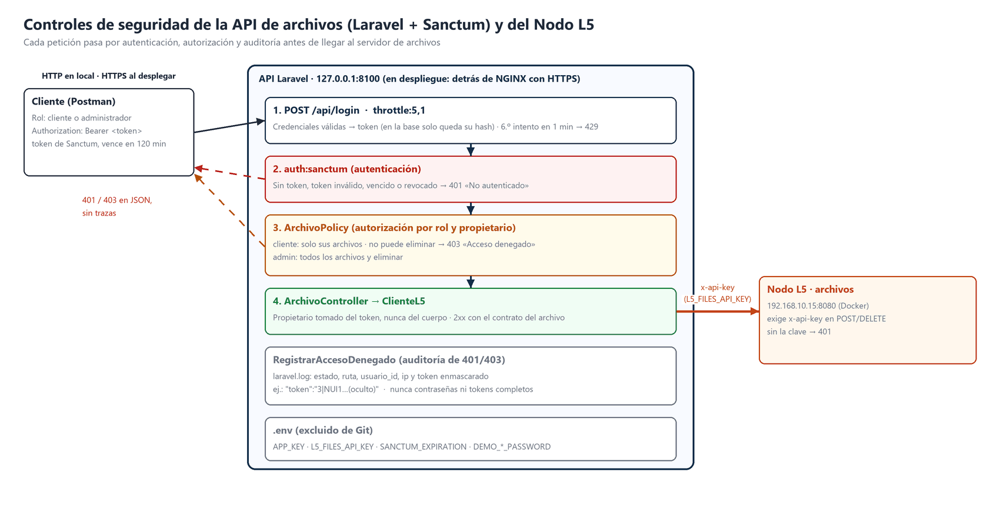

# API segura de archivos · IS-803 tema 2.4

API en **Laravel 13 con Sanctum** que protege los archivos de la tienda en línea, cuyos binarios guarda el **Nodo L5** (servidor de archivos). Implementa:
- **autenticación** con tokens Bearer que vencen;
- **autorización** por rol y por propietario;
- **auditoría** de accesos rechazados sin exponer tokens;
- **gestión de secretos** con variables de entorno;
- una **revisión automática** de que no haya secretos en el repositorio.

Práctica individual · rama `seguridad-angel17jc`.



## Matriz de acceso

Roles: **público** (sin token), **cliente** (usuario autenticado) y **administrador**.

| Endpoint | Método | Público | Cliente | Administrador |
|---|---|---|---|---|
| `/api/login` | POST | Sí, máx. 5 intentos por minuto | Sí | Sí |
| `/api/me` | GET | No (401) | Sí | Sí |
| `/api/logout` | POST | No (401) | Sí, revoca su token | Sí |
| `/api/archivos` | GET | No (401) | Sí, **solo los suyos** | Sí, todos |
| `/api/archivos/{id}` | GET | No (401) | Solo si es suyo; si no, **403** | Sí |
| `/api/archivos` | POST | No (401) | Sí; queda como propietario | Sí |
| `/api/archivos/{id}` | DELETE | No (401) | No (**403**) | Sí |

Entre componentes (servicio a servicio):

| Origen | Destino | Operación | Credencial |
|---|---|---|---|
| API Laravel | Nodo L5 `:8080` | `POST /upload`, `DELETE /files/{clave}` | Cabecera `x-api-key` con `L5_FILES_API_KEY` |
| NGINX (L1) / navegador | Nodo L5 | `GET /files/{clave}` | Lectura pública |
| Cliente | Nodo L5 | Subir o borrar directamente | No permitido: sin la clave, L5 responde 401 |

## Dónde está cada control

| Control | Archivo |
|---|---|
| Rutas públicas y protegidas (`auth:sanctum`, `throttle:5,1`) | [routes/api.php](routes/api.php) |
| Autorización por rol y propietario | [app/Policies/ArchivoPolicy.php](app/Policies/ArchivoPolicy.php) |
| Filtro «solo los suyos» y propietario tomado del token | [app/Http/Controllers/ArchivoController.php](app/Http/Controllers/ArchivoController.php) |
| Inicio de sesión sin registrar contraseñas | [app/Http/Controllers/AuthController.php](app/Http/Controllers/AuthController.php) |
| Auditoría de 401/403 con el token enmascarado | [app/Http/Middleware/RegistrarAccesoDenegado.php](app/Http/Middleware/RegistrarAccesoDenegado.php) |
| Respuestas 401/403/429 en JSON, sin trazas | [bootstrap/app.php](bootstrap/app.php) |
| Credencial de servicio hacia L5 | [app/Services/ClienteL5.php](app/Services/ClienteL5.php) y [config/services.php](config/services.php) |
| Revisión de secretos (P4) | [app/Console/Commands/RevisarSecretos.php](app/Console/Commands/RevisarSecretos.php) |

## Variables de entorno

Solo se documentan los **nombres**. Los valores están únicamente en `.env`, que Git ignora ([.gitignore](.gitignore)). [.env.example](.env.example) trae los nombres con los valores secretos vacíos.

| Variable | Uso |
|---|---|
| `APP_KEY` | Clave de cifrado de Laravel (`php artisan key:generate`) |
| `APP_DEBUG` | `false`: los errores no muestran trazas |
| `L5_FILES_URL` | Dirección del Nodo L5 |
| `L5_FILES_API_KEY` | Credencial de servicio para subir y borrar en L5 |
| `L5_TIMEOUT` | Segundos máximos de espera a L5 |
| `SANCTUM_EXPIRATION` | Minutos de vida de cada token (120) |
| `DEMO_CLIENTE_EMAIL`, `DEMO_CLIENTE_PASSWORD` | Usuaria de demostración Ana (cliente) |
| `DEMO_CLIENTE2_EMAIL`, `DEMO_CLIENTE2_PASSWORD` | Usuario de demostración Luis (cliente) |
| `DEMO_ADMIN_EMAIL`, `DEMO_ADMIN_PASSWORD` | Administrador de demostración |

El seeder **se detiene si falta una contraseña** en `.env`, en lugar de usar una escrita en el código.

## Instalación y ejecución

```bash
composer install
cp .env.example .env          # complete L5_FILES_API_KEY y las DEMO_*_PASSWORD
php artisan key:generate
php artisan migrate --seed    # 3 usuarios y 3 archivos ficticios
```

```powershell
powershell -ExecutionPolicy Bypass -File .\iniciar-seguridad.ps1   # API en http://127.0.0.1:8100
```

Para subir y borrar archivos, el Nodo L5 debe estar activo (`docker compose up -d` en la raíz del repositorio).

## Pruebas

### Automatizadas

```bash
php artisan test     # 20 pruebas: 18 de seguridad y 2 de ejemplo de Laravel
```

| Grupo | Qué comprueban |
|---|---|
| P1 · permitido | el cliente ve solo lo suyo; el admin ve todo; subida con propietario tomado del token; el admin elimina |
| P2 · 401 | sin token en las 5 rutas protegidas; token inválido, vencido y revocado con logout |
| P3 · 403 | el cliente consulta un archivo ajeno; el cliente intenta eliminar (L5 ni se contacta) |
| Secretos | el login no devuelve contraseñas ni hashes; un login fallido no registra la contraseña; bloqueo tras 5 intentos; los registros 401/403 enmascaran el token |
| Robustez | L5 caído → 502 sin registrar el archivo; tipos de archivo no permitidos → 422 |

### Manuales en Postman

1. Importa [postman/Seguridad.postman_collection.json](postman/Seguridad.postman_collection.json).
2. Crea un *environment* con `email_ana`, `password_ana`, `email_admin` y `password_admin`, o importa `postman/local.postman_environment.json`. Ese archivo se genera en tu equipo y Git lo ignora.
3. Ejecuta las peticiones de la carpeta **0. Iniciar sesión**. Los tokens quedan en variables (`{{token_ana}}`, `{{token_admin}}`). No captures esas respuestas: contienen el token.
4. Ejecuta las carpetas **P1**, **P2** y **P3**. Cada petición trae comprobaciones en *Test Results*.

### P4 · Revisión de secretos

```bash
php artisan seguridad:revisar-secretos
```

El comando comprueba que `.env` esté ignorado y que ningún archivo que se subiría al repositorio contenga los valores de `APP_KEY`, `L5_FILES_API_KEY` ni las `DEMO_*_PASSWORD`. También verifica que `.env.example` no tenga valores reales y que `APP_DEBUG=false`. **Nunca imprime los valores.**

## HTTPS/TLS

- **En esta práctica no hay cifrado.** La API corre en `http://127.0.0.1:8100` y L5 en `http://127.0.0.1:8080`; los tokens viajan en texto plano por la interfaz local. Solo es aceptable porque el tráfico no sale del equipo.
- **En el despliegue**, el TLS lo termina **NGINX en L1**, con un certificado de una autoridad reconocida:
  - redirige el puerto 80 al 443;
  - usa solo TLS 1.2 o 1.3;
  - envía HSTS;
  - reenvía a L3 y L5 por la red interna `192.168.10.0/24`.
  
  Ejemplo: [docs/nginx-tls-ejemplo.conf](docs/nginx-tls-ejemplo.conf).
- **Laravel** confía en el proxy L1 (`trustProxies`) para reconocer `X-Forwarded-Proto: https`, y en producción fuerza URL `https` ([AppServiceProvider](app/Providers/AppServiceProvider.php)).

## Auditoría

Cada 401 o 403 queda en `storage/logs/laravel.log`:

```
local.WARNING: Acceso denegado {"estado":403,"metodo":"GET","ruta":"api/archivos/3","usuario_id":1,"token":"3|NUI1…(oculto)","ip":"127.0.0.1"}
```

Los inicios de sesión fallidos se registran con el correo enmascarado (`a***@tienda.test`) y nunca con la contraseña.
